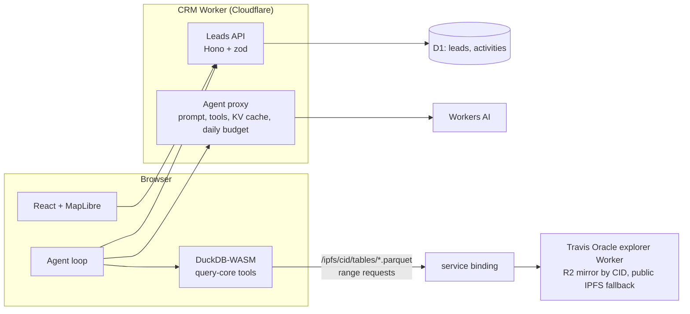

# RoofLead CRM: roofing lead identification for Travis County, TX

A map-based roofing CRM:
- Drop a pin, use GPS or pick a city, and set a radius.
- Find roofs older than a threshold and roofing permits that stayed open for years, with the contractor and its BBB grade.
- Turn the matches into tracked leads.
- Ask an assistant in plain language.

It consumes the published [Travis County Oracle](https://github.com/curiousily/oracle-property-intelligence-platform-pipeline-travis-tx) dataset by CID and runs on free plans.

**Live:** https://roofing-crm.curiousily.workers.dev

The original brief is in [docs/ASSIGNMENT.md](docs/ASSIGNMENT.md).

## Demo path

1. **Prospecting map** opens on Travis County (county outline) and searches 5 miles around Austin.
2. Click the map to drop a pin, or press **Use my location** (positions outside the Travis County outline are refused with a message), then drag the radius.
3. The **Aged roofs** tab lists roofs older than 15 years (configurable), and the orange heatmap shades every match in the radius. The best-evidenced ages come first (completed reroof permit, then new construction, then year built) and are drawn as orange points.
4. The **Open roofing permits** tab lists permits still open 5+ years (configurable), longest open first, drawn as purple points over a purple heatmap of all matches. Each row shows status, open duration, contractor and BBB grade. Toggles add permits that expired without a final inspection, keep only permits that list a contractor, or include accessory work.
5. Click a row or a point to see the permit details:
   - status and years open
   - contractor and phone
   - BBB grade with its snapshot date and match confidence
   - link to the city record
   - the property's owner, mailing address and roof facts
6. Press **+ Lead** or **Add to leads**. The point turns green and the lead appears under **Leads**.
7. **Leads** shows the pipeline. Leads can be:
   - filtered by stage, signal, roof age, permit status, open duration and distance from a place
   - edited for status, priority, next action and notes, with the activity history
8. **Assistant** answers questions such as "Show me open roofing permits older than five years within five miles of Pflugerville". Each answer shows the evidence rows with **+ Lead** buttons, and the assistant can also search your own leads.
9. **Coming soon** (sidebar) and **Outreach** (lead detail) show the disabled expansions: campaigns, estimates, inspections, insurance claims, storm alerts and reports.

## Acceptance criteria

| Criterion | Where |
|---|---|
| Default to a county, explore a selected area | The map opens on the Travis County boundary (Census TIGERweb). Place picker with 51 Census places. |
| Center on GPS or a dropped pin | **Use my location** button; clicking the map drops a pin. |
| Configurable radius | Radius slider, 1–30 miles. |
| Roofs older than a threshold | Aged-roof heatmap of every match, the first 200 as points, and the list. The threshold and the minimum roof-age confidence are adjustable. |
| Open roofing permits, long-open first | Still-open permits sorted by years open, as a heatmap, points and a list. Options: minimum years, add expired-without-final, contractor-only, include accessory work, issued-since year. |
| Permit details with status, open duration, contractor, BBB | Candidate detail panel, lead detail and the assistant's evidence. |
| Browsable list of candidates | **Lead candidates** tabs under the map, with SQL disclosure and dataset CID. |
| Create and manage CRM leads | **+ Lead** on any candidate or evidence row, then the **Leads** pipeline (status, priority, notes, next action, activity history, delete). |
| RAG-backed agent | **Assistant**: retrieval through validated tools over the dataset and your leads, answers grounded in the shown evidence. |
| Filter leads by roof age, permit status and duration, radius | Leads filters. |
| Disabled future sections | Sidebar **Coming soon** and lead **Outreach** buttons. |
| Ingestion out of scope | The CRM only reads the published dataset by CID. |

## How it works



- **Data.** The browser loads the latest publication from `/api/publications` and queries its Parquet tables (`properties`, `roofing_permits`, `contractors`, `permits`) with DuckDB-WASM over HTTP range requests on `/ipfs/<root CID>/…`. The Worker forwards these paths over a service binding to the Oracle explorer, which serves them from its R2 mirror or from public IPFS gateways. No database server is involved.
- **Queries.** [`packages/query-core`](packages/query-core) holds the validated query tools. It is vendored from the pipeline repo (at `30afe41`) as the shared data-model contract. Radius search uses haversine distance with a bounding-box prefilter.
- **Leads.** Leads live in D1 (`migrations/`).
  - **Workspaces.** Every browser gets its own workspace id, so reviewers do not see or overwrite each other's leads. The sidebar can start a new workspace.
  - **What a lead keeps.** A snapshot of the property and permit facts, the signals that found it, and the dataset root CID and build it came from.
  - **Merging.** Adding the same property again merges the new signal instead of duplicating it. A second open permit on the same property is logged, and the lead keeps the facts of the longest-open one.
  - **Edits.** Each edit writes only the changed columns and an activity record, so concurrent edits do not overwrite each other.
  - **Priority.** High when a permit has been open 5+ years, or a roof is 20+ years old with permit-based evidence; otherwise medium. Merging can raise the priority but never lowers it.
- **Assistant.**
  - **The loop.** The browser runs the tool loop. The Worker adds the system prompt and the tool list (query-core tools plus `search_my_leads`), validates the conversation, and calls `@cf/qwen/qwen3-30b-a3b-fp8`.
  - **Costs.** Identical conversations are answered from a KV cache.
  - **Limits.** Each address may ask 20 questions a minute. The app keeps a soft daily cap of about 4,500 neurons, counted in KV. The hard limit is the account's free 10,000 neurons a day; Workers AI stops there, so nothing is ever billed.
  - **Grounding.** Tool results go back to the model compactly, while the UI shows the full evidence and SQL.

## Cost

| Part | Platform | Plan |
|---|---|---|
| UI and API | Cloudflare Workers + static assets | Free plan |
| Leads | Cloudflare D1 | Free tier |
| Assistant model | Workers AI | Free 10,000 neurons a day, shared with the Oracle explorer, 4,500 for this app |
| Answer cache and budget | Workers KV | Free tier |
| Property data | Published Travis County Oracle dataset on IPFS, queried in the browser | No server |
| CI, deploy, end-to-end playthrough | GitHub Actions | Free for public repositories |

## Run it

```bash
nvm use && npm ci
npm test && npm run typecheck && npm run lint

cd packages/app
npm run dev        # local UI and Worker against the deployed D1, KV and Oracle explorer (remote bindings; needs wrangler login)
npm run e2e        # Playwright playthrough of the demo path against the deployed CRM
npm run deploy     # build and deploy (after: npx wrangler d1 migrations apply roofing-crm --remote)
```

Pushes to `travis-crm` run [deploy.yml](.github/workflows/deploy.yml): tests, D1 migrations, deploy, and a Playwright playthrough of the deployed site whose screenshots are kept as an artifact.

## Layout

| Path | Contents |
|---|---|
| `packages/app/worker` | Worker: `leads/` (domain rules, service, D1 repository, Hono routes), `agent/` (Workers AI proxy, CRM prompt and tools), entry point |
| `packages/app/src` | React UI: pages (prospecting, leads, assistant), MapLibre map with the county outline, DuckDB-WASM data layer, agent loop, leads client |
| `packages/app/migrations` | D1 schema |
| `packages/app/test`, `packages/app/e2e` | Unit and integration tests (leads API against SQLite, agent proxy, agent loop, clients); Playwright demo-path tests |
| `packages/query-core` | Vendored query tools and their tests |

## Kit conformance and deviations

The soofi-xyz team kit is enabled in this repository (`.claude/settings.json`).

**Followed:**
- **Monorepo and contracts.** One npm-workspaces repository whose zod schemas are shared by the UI, the Worker API and the agent tools, with separate frontend and API surfaces.
- **Retrieval and evaluation.** Hybrid retrieval through structured filters and exact identifiers. Golden-path tests run the agent loop and API against fixtures with a mocked model.

**Not followed:**
- **Hosting.** The kit's golden path is AWS: Amplify, CDK and tRPC for full-stack work, and Bedrock with OpenSearch for retrieval agents. This CRM runs on Cloudflare's free plan (Workers, D1, KV, Workers AI) instead, because the brief's data side requires no ongoing infrastructure cost and both apps share one free account.
- **Retrieval method.** The assistant retrieves through validated SQL tools rather than a vector index. Questions about roof age, permits and radius are structured, and every answer stays traceable to its rows and SQL.

## Known limitations

- **Data coverage.** Permit data covers the City of Austin only, and BBB grades exist only where an archived profile matched the contractor (see the Oracle repository).
- **No user accounts.** Workspaces are per browser. Sign-in and shared team workspaces are the natural next step.
- **Dataset dependency.** The dataset reaches the CRM through a service binding to the Oracle explorer Worker in the same Cloudflare account. Another deployment needs that explorer, or a change of the binding to a public IPFS gateway.
